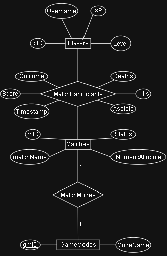

# ex603-game-telemetry-database

Theme: Game Telemetry

This project will exhibit an example of a game telemetry database that collects, analyzes, and utilizes data of a video game about the players, the matches, and the participants (including, but not limited, to the aforementioned players) and their scores, the game and match modes, for each match (mainly upon their conclusion).

## Domain

For the project, there are six domains that it could take the form of, all sharing the underlying structure of five rows: actor, producer, event, catalog, and junction, alongside a numeric metric.  The domain that I chose for mine is Game Telemetry, where the player serves as an actor, the match serves as the producer, match participants serves as an event, game modes serve as a catalog, match modes serve as the junction, and score serves as the metric.  The reason I chose this domain is because I have a passion for video games, as I have played a wide variety of their genres, including (but not limited to) adventure, FPSes, puzzles, racing, and strategy games.

Although I am more into single-player games, I have also played (competitive) multiplayer games, such as Call of Duty.  In the case of my project, I will emulate a game telemetry database of a competitive online multiplayer FPS game, since I have always believed that no games of that kind is complete without it.  By creating the project, I am looking forward to answer how the data is collected and managed by that game, given that I should be familiar with data management subjects since my years as an undergraduate.

## Schema

* **Players** - An actor table that stores player records.  Here, each player is identified with a unique username to prevent confusion, along with their unique ID serving both as a primary key of this table and surrogate key for performance-related purposes.
* **Matches** - A producer table that stores game match records.  Here, each match is mainly identified by its unique ID, also a surrogate key for performance-related purposes, and they have a status attribute that indicates whether it has either not started yet, started, or completed.  It also has another attribute that tracks how many players are participating in it, which could be used in queries with sorting or filtering purposes.
* **MatchParticipants** - An events table that serve as a connection between matches and players.  In it, a player can participate in many matches, but they can only participate in the same match at least once.  For each player participation, a timestamp that records when the player joined the match is included, along with their score.  In addition, each player participation comes with an attribute that indicates the player's status (i.e. Victory, Draw, or Defeat), faction (if the match is set to a team-based gamemode), and a few other statistics (i.e. kills, deaths, and assists) in the match.  This table uses a composite primary keys of player and match IDs that serve as foreign keys to their respective tables.
* **GameModes** - A catalog table that stores game mode records.  Here, each game mode is identified with a unique name to prevent confusion, along with its unique ID serving both as a primary key of this table and surrogate key for performance-related purposes.  In addition, each game mode comes with its description, as well as a boolean that identifies whether the mode is team-based or not.
* **MatchModes** - A junction table that serves as a connection between matches and game modes.  Here, a game mode can be associated with many matches, but a match should only be assigned exactly one game mode.  This table uses a composite primary keys of match and game mode IDs that serve as foreign keys to their respective tables, alongside a timestamp attribute that records when the match is assigned its game mode.

## Query Catalogue

### Unit 4

| Query | Business question |
| --- | --- |
| SELECT COUNT(score) AS total_plays, ROUND(AVG(score), 2) AS average_score_per_match, MIN(score) AS minimum_score, MAX(score) AS maximum_score, COUNT(DISTINCT player_id) AS unique_participants FROM match_participants; | How many participation records and (unique) players are there, and what is the average, lowest, and highest score? |
| SELECT match_id, COUNT(\*) AS total_participations, ROUND(AVG(score), 2) AS average_score FROM match_participants GROUP BY match_id ORDER BY total_participations DESC; | For each match, how many participation records, and what is the average score? |
| SELECT match_id, COUNT(\*) AS total_participations, ROUND(AVG(score), 2) AS average_score FROM match_participants GROUP BY match_id HAVING COUNT(\*) > 16 ORDER BY total_participations DESC; | Which matches have more than sixteen records?  For each of these matches, how many of them, and what is the average score? |
| SELECT match_id, client_region, COUNT(*) AS total_participations, ROUND(AVG(score), 2) AS average_score, MIN(score) AS minimum_score, MAX(score) AS maximum_score, COUNT(DISTINCT player_id) AS unique_participants FROM match_participants GROUP BY (match_id, client_region) ORDER BY match_id; | For each pair of match and the client region, how many many participation records and (unique) players are there, and what is the average, lowest, and highest score? |
| SELECT match_id, COUNT(\*) AS total_participations, COUNT(CASE WHEN disconnect_reason = 'Network timeout' THEN 1 END) AS network_timeouts FROM match_participants GROUP BY match_id ORDER BY match_id; | For each match, how many participation records are there, and how many of them ended with network timeouts? |
| SELECT CASE WHEN GROUPING(client_region) = 1 THEN 'All regions' ELSE client_region::TEXT END as client_region, COUNT(\*) AS total_participations, COUNT(CASE WHEN disconnect_reason = 'Network timeout' THEN 1 END) AS network_timeouts FROM match_participants GROUP BY ROLLUP(client_region); | Both overall and for each client region, how many participation records are there, and how many of them ended with network timeouts? |
| WITH match_performance AS ( SELECT match_id, COUNT(\*) AS total_participations, ROUND(AVG(score), 2) AS average_score FROM match_participants GROUP BY match_id ), average_participation_per_match AS ( SELECT ROUND(AVG(total_participations)) AS average_participations FROM match_performance ) SELECT match_id, total_participations, average_score FROM match_performance CROSS JOIN average_participation_per_match WHERE total_participations > average_participations ORDER BY total_participations DESC; | What should be the minimum number of participants to consider for each match, and which matches meet this threshold? |
